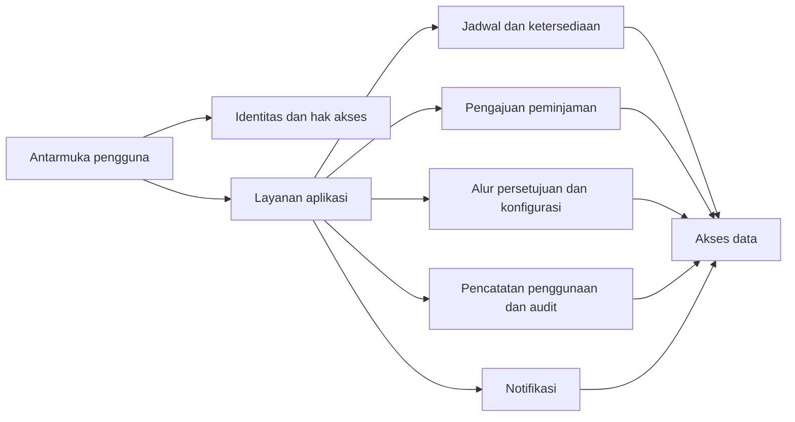
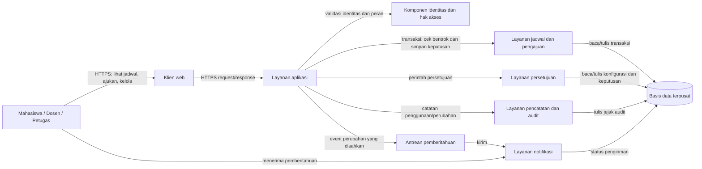
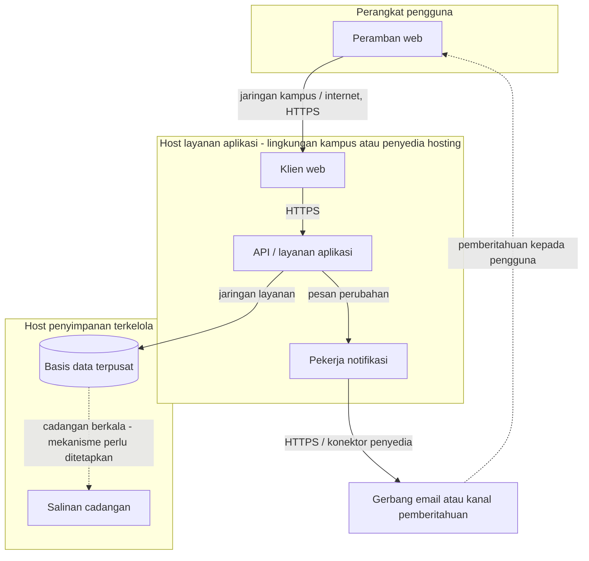

# B3. Tiga Struktur Arsitektur

**Penanggung jawab: Rendi Pratama**

## 1. Tujuan dan dasar rancangan

Bagian ini menggambarkan rancangan awal subsistem *Laboratory Management* untuk layanan peminjaman ruang laboratorium FIKOM UMI. Tiga struktur yang digunakan adalah struktur modul, struktur komponen dan konektor (*component-and-connector*/C&C), serta struktur alokasi. Ketiganya menunjukkan aspek yang berbeda dari sistem yang sama: pembagian unit perangkat lunak, interaksi saat sistem berjalan, serta penempatan perangkat lunak pada lingkungan operasional. Pengelompokan ini mengikuti kategori *viewtype* pada pendekatan *Views and Beyond* dari Software Engineering Institute (SEI) [1].

Rancangan ini adalah **usulan konseptual**, bukan arsitektur yang sudah diputuskan atau diimplementasikan. Repo belum memuat A1, A5, atau B5, sehingga pemilihan struktur dan trade-off akhir perlu disahkan pada bagian keputusan arsitektur (A5) dan analisis trade-off (B5).

Dasar kebutuhan yang dipakai:

- **ASR-1:** mencegah jadwal ganda, menjaga konsistensi jadwal, serta mengirim pemberitahuan perubahan paling lama lima menit (target usulan).
- **ASR-2:** aturan laboratorium dan alur persetujuan dapat diubah admin tanpa mengubah kode (target usulan).
- **ASR-3:** pencatatan penggunaan dan perubahan status harus dapat ditelusuri serta dibatasi menurut hak akses (target usulan).
- **ASR-4:** layanan dapat diakses minimal 99% dari jam kerja per bulan (target usulan).
- **Batasan A3:** ruang lingkup berfokus pada peminjaman ruang laboratorium; jadwal akademik menjadi data acuan; akses memerlukan jaringan; dan akses administrasi dibedakan berdasarkan peran.

Angka target di atas masih berupa sasaran rancangan dari A4/B2, belum merupakan hasil pengujian.

## 2. Struktur modul

Struktur modul menunjukkan pembagian tanggung jawab pada unit perangkat lunak dan ketergantungan antarmodul. Rancangan awal membagi tanggung jawab sebagai berikut.

| Modul | Tanggung jawab | Kebutuhan yang didukung |
|---|---|---|
| Antarmuka pengguna | Menampilkan ketersediaan dan riwayat; menerima pengajuan; menyediakan layar kerja admin/petugas. | A2, A3; kemudahan penggunaan |
| Identitas dan hak akses | Mengenali pengguna dan memeriksa kewenangan sebelum operasi dilakukan. | ASR-3; O1 |
| Pengajuan peminjaman | Memvalidasi kelengkapan permohonan dan meneruskan permohonan untuk diperiksa. | BAB I; B2 batasan |
| Jadwal dan ketersediaan | Membaca jadwal, memeriksa bentrokan, dan menjaga agar satu ruang tidak ditetapkan untuk dua kegiatan pada waktu yang sama. | ASR-1; T2, B3 |
| Alur persetujuan dan konfigurasi | Mengelola tahapan, pihak yang menyetujui, jenis keperluan, dan konfigurasi ruang sebagai data. | ASR-2; B2 batasan |
| Pencatatan penggunaan dan audit | Mencatat waktu mulai/selesai, tujuan, peminjam, kondisi ruang, serta jejak perubahan. | ASR-3; O2, O3 |
| Notifikasi | Mengirim pemberitahuan kepada pihak terdampak setelah keputusan atau perubahan jadwal. | ASR-1 |
| Akses data | Menyimpan dan mengambil data ruang, jadwal, permohonan, persetujuan, penggunaan, dan audit. | ASR-1, ASR-3, ASR-4 |

Ketergantungan yang diusulkan: antarmuka menggunakan layanan aplikasi; layanan aplikasi menggunakan modul identitas, pengajuan, jadwal, persetujuan, pencatatan, dan notifikasi; modul-modul tersebut mengakses data melalui modul akses data. Aturan bentrokan dan kewenangan tidak sebaiknya hanya diperiksa di antarmuka, agar jalur akses lain tetap mengikuti validasi yang sama.

**Gambar B3-1.** Struktur modul konseptual. Panah menunjukkan ketergantungan atau penggunaan layanan, bukan aliran data rinci.

## 3. Struktur komponen dan konektor saat runtime

Struktur C&C menunjukkan komponen yang aktif ketika layanan digunakan dan cara mereka berkomunikasi. Usulan berikut memakai pola klien–server dengan layanan aplikasi terpusat dan penyimpanan bersama. Pilihan ini selaras dengan batasan T3 tentang akses jaringan dan data jadwal terpusat, tetapi belum merupakan keputusan final A5.

**Gambar B3-2.** Komponen dan konektor runtime yang diusulkan. Konektor HTTPS dan transaksi ditampilkan sebagai konsep; teknologi/protokol spesifik belum ditetapkan.

### Alur penting

1. Pengguna meminta jadwal atau mengirim permohonan melalui klien web.
2. Layanan aplikasi memeriksa identitas dan peran. Untuk pengajuan, layanan jadwal memeriksa ketersediaan dan menyimpan keputusan dalam transaksi agar permohonan bersamaan tidak menghasilkan dua jadwal yang bertumpang tindih.
3. Petugas berwenang memutuskan permohonan atau mengesahkan perubahan jadwal. Perubahan dan pelakunya dicatat dalam jejak audit.
4. Setelah perubahan disahkan, sistem meneruskan pemberitahuan melalui komponen notifikasi. Pengiriman tidak mengubah keputusan jadwal; status pengiriman dicatat agar kegagalan dapat ditindaklanjuti.

Antrean notifikasi adalah usulan untuk memisahkan pengiriman pesan dari transaksi utama. Rancangan ini dapat membantu agar pengiriman yang lambat tidak menghalangi penyimpanan keputusan, tetapi perlu mekanisme percobaan ulang dan pemantauan untuk mendukung target ASR-1. Detail mekanisme tersebut harus ditentukan pada A5/B5.

## 4. Struktur alokasi

Struktur alokasi menghubungkan elemen perangkat lunak dengan lingkungan tempat sistem dikembangkan atau dijalankan. Berikut adalah rancangan penempatan konseptual, bukan spesifikasi infrastruktur final.

**Gambar B3-3.** Alokasi konseptual perangkat lunak ke perangkat pengguna, host aplikasi, penyimpanan, dan gerbang pemberitahuan.

Penempatan basis data terpusat mendukung satu sumber data jadwal, sedangkan pemisahan pekerja notifikasi membuka ruang untuk mengelola pengiriman dan percobaan ulang secara terpisah. Namun, target ketersediaan ASR-4 belum dapat dijamin hanya dari gambar ini. Kebutuhan redundansi, pemulihan, keamanan jaringan, lokasi hosting, retensi cadangan, serta tanggung jawab operasional masih harus diputuskan dan diuji.

## 5. Keterkaitan struktur dengan atribut kualitas

| Atribut/kebutuhan | Elemen rancangan yang mendukung | Hal yang masih perlu dibuktikan |
|---|---|---|
| Konsistensi jadwal (ASR-1) | Pemeriksaan bentrokan pada layanan jadwal; penyimpanan transaksi pada satu sumber data. | Uji 30 pengajuan bersamaan dan pemeriksaan tidak ada jadwal ganda. |
| Pemberitahuan perubahan (ASR-1) | Komponen notifikasi yang terpisah dan pencatatan status pengiriman. | Uji tenggat lima menit, tingkat keberhasilan, dan pemulihan kegagalan pengiriman. |
| Perubahan aturan (ASR-2) | Modul konfigurasi/alur persetujuan memisahkan aturan dari antarmuka. | Uji perubahan oleh admin tanpa mengubah kode dan uji pengajuan setelah perubahan. |
| Akuntabilitas dan hak akses (ASR-3) | Modul identitas, pemeriksaan kewenangan di layanan, dan jejak audit. | Uji akses per peran, kelengkapan catatan, serta ketahanan jejak audit. |
| Ketersediaan (ASR-4) | Alokasi layanan dan data terpusat; cadangan ditampilkan sebagai kebutuhan rancangan. | Tetapkan strategi redundansi/pemulihan dan ukur waktu aktif terhadap jam kerja. |

## 6. Ringkasan trade-off awal

- **Modul yang terpisah** membantu memisahkan kebijakan persetujuan, pemeriksaan jadwal, audit, dan notifikasi. Biayanya adalah lebih banyak batas antarmodul yang harus didefinisikan dan dijaga.
- **Layanan aplikasi terpusat** menyederhanakan konsistensi jadwal dan administrasi awal. Jika beban meningkat, kapasitas dan titik kegagalan terpusat perlu ditinjau.
- **Antrean notifikasi** memisahkan pemberitahuan dari transaksi pengajuan, tetapi memerlukan pemantauan, percobaan ulang, dan penanganan pesan gagal.
- **Basis data terpusat** memberi acuan jadwal yang konsisten, tetapi menuntut strategi cadangan dan pemulihan untuk mendukung ketersediaan.

Perbandingan ini merupakan masukan untuk B5, bukan keputusan final. A5 perlu menetapkan pilihan dan alasan berdasarkan ASR, batasan, biaya, serta kemampuan operasional yang benar-benar tersedia.

## 7. Referensi

[1] P. C. Clements, F. Bachmann, L. Bass, D. Garlan, J. Ivers, R. Little, R. Nord, dan J. Stafford, *Documenting Software Architectures: Views and Beyond*, CMU/SEI-2005-TN-017, Software Engineering Institute, Carnegie Mellon University, 2005, khususnya §2.2. [PDF resmi SEI](https://www.sei.cmu.edu/documents/2072/2005_004_001_14498.pdf).
