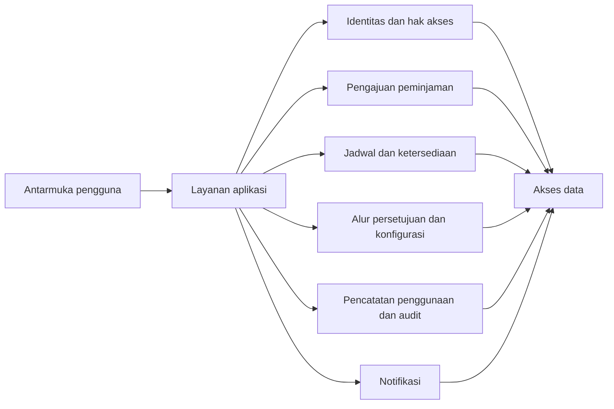
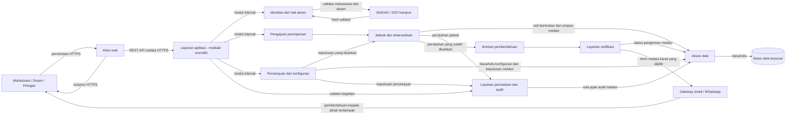
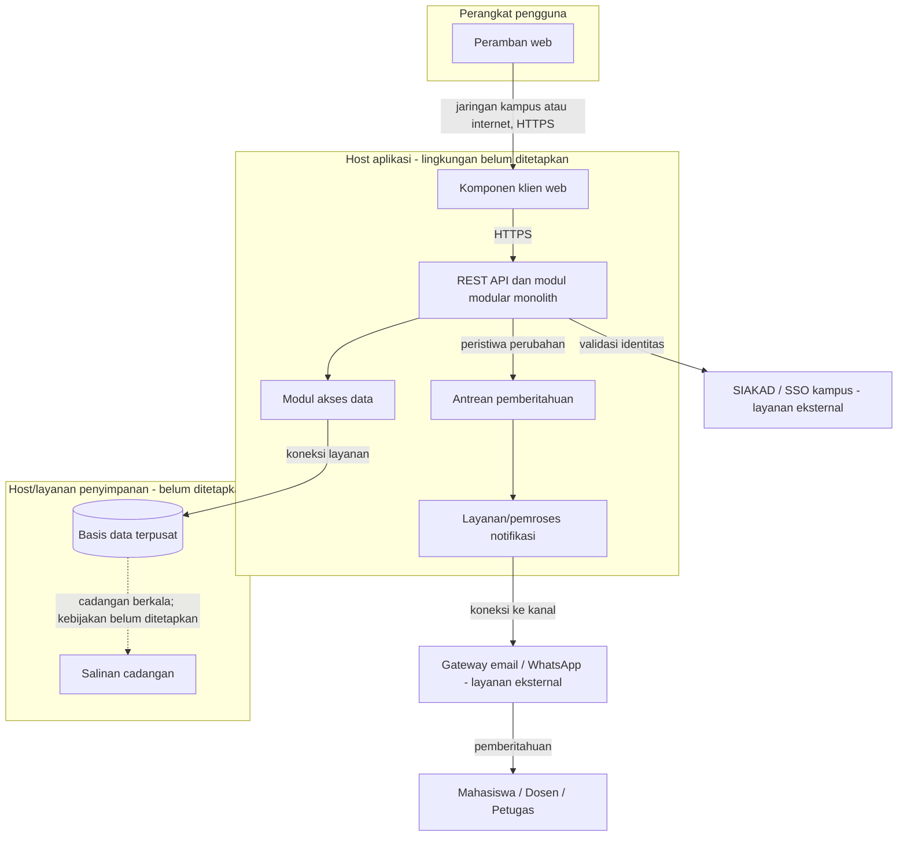

# B3. Tiga Struktur Arsitektur

**Penanggung jawab: Rendi Pratama**

## 1. Tujuan dan dasar rancangan

Bagian ini menggambarkan usulan arsitektur untuk subsistem *Laboratory Management*, khususnya layanan peminjaman ruang laboratorium di Fakultas Ilmu Komputer Universitas Muslim Indonesia (FIKOM UMI). Pembahasan menggunakan tiga kategori struktur: struktur modul, struktur komponen dan konektor (*component-and-connector*/C&C), serta struktur alokasi. Struktur modul menunjukkan unit perangkat lunak dan ketergantungannya; C&C menunjukkan komponen runtime dan komunikasinya; struktur alokasi menunjukkan hubungan perangkat lunak dengan lingkungan operasional [1, §2.2].

Rancangan konseptual ini menggunakan pola *modular monolith* dengan pendekatan *client-server* berbasis REST API dan basis data relasional. Integrasi SIAKAD/SSO serta gateway email/WhatsApp merupakan bagian dari konteks sistem. Konsistensi data diprioritaskan dalam pengelolaan jadwal, sementara pilihan vendor, kanal notifikasi, dan spesifikasi hosting masih perlu ditetapkan. Rancangan ini belum diimplementasikan atau diuji.

Rancangan mencakup integrasi SIAKAD/SSO untuk validasi identitas mahasiswa dan dosen. Mekanisme autentikasi petugas perlu ditetapkan pada tahap perancangan lebih lanjut.

Rancangan diturunkan dari kebutuhan yang sudah dicatat:

- **ASR-1:** mencegah jadwal ganda dan memberi tahu pihak terdampak paling lama lima menit setelah perubahan disahkan; nol jadwal ganda pada 30 pengajuan bersamaan adalah target usulan.
- **ASR-2:** admin dapat mengubah konfigurasi laboratorium dan alur persetujuan tanpa perubahan kode; penerapan paling lama satu jam kerja adalah target usulan.
- **ASR-3:** penggunaan dan perubahan status dicatat, jejak perubahan dipertahankan, dan akses dibatasi menurut kewenangan.
- **ASR-4:** target ketersediaan layanan minimal 99% dari jam kerja per bulan.
- **Batasan A3:** fokus layanan adalah peminjaman ruang laboratorium; data jadwal menjadi acuan; pengguna mengakses layanan melalui jaringan; dan kewenangan operasional dibedakan berdasarkan peran.

Semua angka di atas merupakan **target usulan dalam A4, B2, dan B4**, bukan hasil implementasi atau pengukuran.

## 2. Struktur modul

Struktur modul membagi tanggung jawab perangkat lunak dan menunjukkan ketergantungan antarmodul. Komponen di bawah adalah unit logis untuk analisis, bukan nama paket atau layanan yang sudah dibuat dalam kode.

| Modul | Tanggung jawab | Kebutuhan yang didukung |
|---|---|---|
| Antarmuka pengguna | Menampilkan jadwal, ketersediaan, status, dan riwayat; menerima permohonan; menyediakan fungsi bagi admin/petugas. | Kasus penggunaan BAB I; kebutuhan stakeholder A2 |
| Layanan aplikasi | Mengatur alur permohonan, pemeriksaan kewenangan, persetujuan, pencatatan, dan respons ke antarmuka. | Pemisahan alur dan validasi lintas fungsi |
| Identitas dan hak akses | Memvalidasi identitas mahasiswa dan dosen melalui SIAKAD/SSO sesuai A1 serta memeriksa kewenangan pengguna; autentikasi petugas perlu ditetapkan. | ASR-3; A1; A3-O1 |
| Pengajuan peminjaman | Memvalidasi kelengkapan permohonan dan meneruskan permohonan untuk diproses. | Kasus penggunaan BAB I; A3-B2 |
| Jadwal dan ketersediaan | Membaca jadwal, memeriksa bentrokan, dan menjaga konsistensi penetapan ruang dan waktu. | ASR-1; A3-T2 dan A3-B3 |
| Alur persetujuan dan konfigurasi | Mengelola tahapan dan pihak yang menyetujui, jenis keperluan, serta konfigurasi ruang sebagai data. | ASR-2; A3-B2 |
| Pencatatan penggunaan dan audit | Mencatat peminjam, tujuan, waktu mulai/selesai, kondisi ruang, dan jejak perubahan. | ASR-3; A3-O2 dan A3-O3 |
| Notifikasi | Meneruskan pemberitahuan perubahan yang telah disahkan melalui gateway email/WhatsApp dan mencatat status pengirimannya. | ASR-1; A1 |
| Akses data | Menyimpan dan mengambil data pengguna, ruang, jadwal, permohonan, persetujuan, penggunaan, konfigurasi, dan audit. | ASR-1, ASR-2, ASR-3, ASR-4 |

Ketergantungan yang diusulkan: antarmuka menggunakan layanan aplikasi; layanan aplikasi menggunakan modul identitas, pengajuan, jadwal, persetujuan, pencatatan, dan notifikasi; modul-modul tersebut menggunakan akses data. Pemeriksaan kewenangan dan bentrokan jadwal dilakukan pada layanan terkait, bukan hanya di antarmuka, supaya semua jalur permintaan tunduk pada aturan yang sama.

**Gambar B3-1.** Struktur modul konseptual. Panah menunjukkan ketergantungan antarmodul, bukan urutan pesan saat runtime.

## 3. Struktur komponen dan konektor saat runtime

Struktur C&C menggambarkan komponen yang berinteraksi ketika layanan digunakan. Mengikuti A5, usulan ini memakai pola klien–server berbasis REST API dengan modul-modul yang berjalan sebagai satu *modular monolith*. Penyimpanan relasional menjadi acuan jadwal bersama. HTTPS, transaksi, dan integrasi sistem eksternal ditunjukkan secara konseptual; vendor RDBMS, mekanisme transaksi rinci, dan kanal notifikasi yang dipakai belum dipilih. Akses persisten melalui modul/komponen akses data pada Gambar B3-1 dan B3-2, bukan melalui ketergantungan langsung setiap modul pada basis data.

**Gambar B3-2.** Komponen dan konektor runtime yang diusulkan. SIAKAD/SSO dan gateway email/WhatsApp mengikuti konteks A1; pemilihan kanal spesifik dan detail integrasi masih perlu diputuskan.

Alur penting yang ditunjukkan:

1. Pengguna meminta informasi jadwal atau mengirim permohonan melalui klien web.
2. Layanan aplikasi memeriksa identitas dan kewenangan. Permohonan diteruskan ke layanan jadwal untuk memeriksa bentrokan sebelum jadwal ditetapkan.
3. Pihak berwenang menyetujui/menolak permohonan atau mengesahkan perubahan. Keputusan dan penggunaan ruang dicatat agar dapat ditelusuri.
4. Setelah perubahan jadwal disahkan dan disimpan, peristiwa perubahan diteruskan melalui antrean ke layanan notifikasi, lalu dikirim ke pihak terdampak melalui kanal yang nantinya dipilih.

Pemeriksaan dan penyimpanan jadwal harus menangani permohonan bersamaan agar tidak menghasilkan jadwal ganda. A5 telah memilih RDBMS, tetapi mekanisme spesifik—misalnya batasan transaksi atau penguncian data—tetap perlu ditetapkan dan diuji sesuai B2. Antrean pada diagram merupakan komponen logis untuk memisahkan pengiriman notifikasi dari transaksi utama; teknologi, pemantauan, percobaan ulang, dan jaminan pesan tidak hilang perlu diputuskan sebelum implementasi.

## 4. Struktur alokasi

Struktur alokasi menghubungkan komponen perangkat lunak dengan perangkat dan lingkungan operasionalnya. Diagram ini menunjukkan **penempatan konseptual**, bukan spesifikasi hosting yang sudah dipilih. Modul aplikasi ditempatkan bersama sebagai *modular monolith*, sedangkan RDBMS menjadi penyimpanan terpisah. Jenis host, penyedia, kanal notifikasi, dan mekanisme cadangan masih terbuka.

**Gambar B3-3.** Alokasi konseptual klien, aplikasi modular, pemroses notifikasi, RDBMS, layanan SIAKAD/SSO, gateway email/WhatsApp, dan cadangan.

Basis data terpusat dimaksudkan menjadi acuan jadwal. Pemisahan antrean/pemroses notifikasi memberi ruang untuk menangani pengiriman tanpa menahan respons permohonan. Akan tetapi, satu host aplikasi dan satu basis data pada gambar tidak menjamin target ASR-4 sebesar 99%. Redundansi, pemulihan gangguan, keamanan jaringan, retensi cadangan, dan tanggung jawab operasional perlu dipilih dan diuji sebelum target ketersediaan dapat dinilai.

## 5. Keterkaitan struktur dengan atribut kualitas

| Atribut/kebutuhan | Elemen rancangan yang mendukung | Hal yang perlu diputuskan atau dibuktikan |
|---|---|---|
| Konsistensi jadwal (ASR-1) | Pemeriksaan bentrokan pada layanan jadwal dan penyimpanan bersama. | Pilih mekanisme transaksi untuk permohonan bersamaan; uji 30 pengajuan dan pastikan tidak ada jadwal ganda. |
| Pemberitahuan perubahan (ASR-1) | Antrean dan layanan notifikasi yang terpisah dari proses persetujuan. | Pilih kanal, mekanisme pemulihan/pengiriman ulang, dan ukur batas lima menit serta tingkat keberhasilan pada B2. |
| Perubahan aturan (ASR-2) | Modul alur persetujuan dan konfigurasi memisahkan aturan dari kode alur utama. | Buktikan admin dapat mengubah aturan tanpa perubahan kode dan aturan baru berlaku sesuai target B2. |
| Keamanan dan auditabilitas (ASR-3) | Pemeriksaan kewenangan di layanan dan modul jejak audit. | Uji akses per peran, kelengkapan catatan, dan pencegahan perubahan tanpa jejak. |
| Ketersediaan (ASR-4) | Alokasi layanan dan data terpusat; kebutuhan cadangan ditampilkan. | Tetapkan strategi redundansi/pemulihan dan ukur waktu aktif terhadap jam kerja. |
| Kinerja (B1) | Layanan aplikasi dan akses data menjadi jalur utama permintaan. | Tetapkan target waktu respons dan lakukan pengukuran sebelum menilai kinerja rancangan. |

## 6. Trade-off rancangan awal

- **Pemisahan modul** membantu memisahkan aturan persetujuan, pemeriksaan jadwal, audit, dan notifikasi. Dampaknya, batas tanggung jawab serta kontrak antarmodul perlu didefinisikan dengan jelas.
- **Layanan aplikasi terpusat** memberi satu jalur validasi dan menyederhanakan konsistensi jadwal. Dampaknya, kapasitas serta ketersediaan host aplikasi dan basis data menjadi penting.
- **Antrean pemberitahuan** memungkinkan pengiriman berjalan terpisah dari transaksi permohonan. Dampaknya, sistem perlu memantau antrean, mencoba ulang pesan gagal, dan mencegah atau menangani pesan ganda.
- **Basis data terpusat** menyediakan acuan jadwal bersama. Dampaknya, ketersediaan dan pemulihan basis data perlu dirancang untuk memenuhi ASR-4.

Trade-off ini melengkapi keputusan awal A5 dan B5. A5 memilih *modular monolith*, REST API, dan RDBMS; B5 memprioritaskan konsistensi dibanding kinerja murni serta keamanan dibanding kemudahan penggunaan. Pilihan vendor, target waktu respons, strategi ketersediaan, detail integrasi, dan bukti pengujian masih perlu ditetapkan sebelum implementasi.

## 7. Referensi

[1] P. C. Clements, *Comparing the SEI’s Views and Beyond Approach for Documenting Software Architectures with ANSI-IEEE 1471-2000*, CMU/SEI-2005-TN-017, Software Engineering Institute, Carnegie Mellon University, 2005, §2.2. [PDF resmi SEI](https://www.sei.cmu.edu/documents/2072/2005_004_001_14498.pdf).
