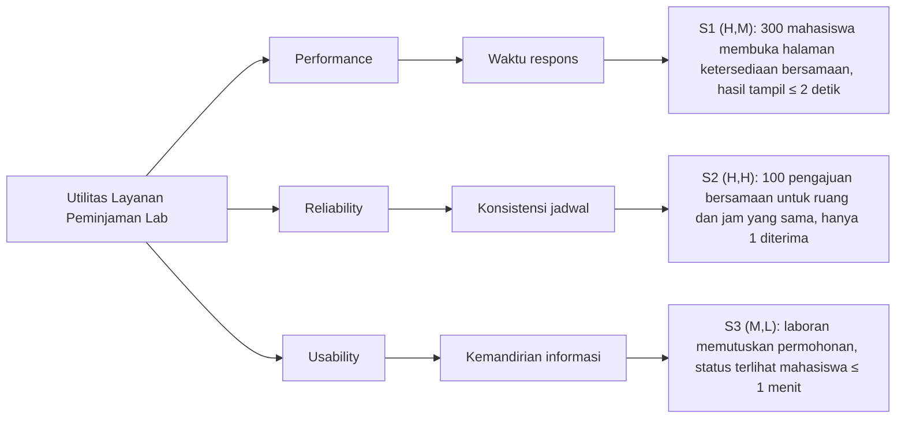

# BAB V EVALUASI DAN ADR

**Nama:** Rendi Pratama  
**NIM:** 13020240184  
**Bagian:** U6 – Evaluasi

Bab ini mengevaluasi rancangan Layanan Peminjaman Ruang Laboratorium FIKOM UMI terhadap tiga skenario pada BAB II, taktik pada BAB III, dan pola pada BAB IV. Evaluasi memakai pohon utilitas dan analisis ala ATAM [1], [3]. Nama komponen mengikuti Gambar 5.2 dan 5.3.

Masalah utama yang dievaluasi (BAB I, subbab 1.2): **informasi ketersediaan laboratorium belum dapat diketahui mahasiswa secara mandiri, sehingga mahasiswa harus bertanya langsung kepada laboran** (Bukti 1 dari R1 dan Bukti 2 dari R2).

## 5.1 Pohon Utilitas Mini

Setiap skenario diberi peringkat (kepentingan bisnis, kesulitan teknis) dengan nilai H (tinggi), M (sedang), atau L (rendah) [3].

*Gambar 5.5 Pohon utilitas mini*

| Skenario | Kepentingan | Kesulitan | Alasan peringkat |
|---|---|---|---|
| S1 – Performance | H | M | Langsung menjawab masalah utama: mahasiswa melihat ketersediaan sendiri. Beban 300 pengguna masih wajar untuk satu server dengan indeks basis data. |
| S2 – Reliability | H | H | Informasi ketersediaan hanya dapat dipercaya jika satu slot tidak pernah diberikan kepada dua peminjam (kendala dari R2). Penanganan 100 permintaan serentak sulit dibuat benar dan diuji. |
| S3 – Usability | M | L | Mendukung masalah utama (Bukti 3 dari R1). Penerapannya sederhana dengan polling. |

Prioritas evaluasi: **S2 → S1 → S3**. Skenario (H,H) mendapat perhatian terbesar dalam analisis risiko.

## 5.2 Trade-off Berbobot Dua Alternatif

- **Alternatif A (dipilih):** Client-Server dengan pola Layered, Repository, dan State; transaksi dengan penguncian slot (*pessimistic locking*); polling status setiap 30 detik.
- **Alternatif B:** *Microservices* (layanan ketersediaan, peminjaman, dan status terpisah, masing-masing dengan basis data sendiri); *optimistic locking*; status dikirim langsung melalui WebSocket.

Skor 1–5 (5 = paling baik). Nilai = bobot × skor.

| Kriteria | Bobot | Skor A | Nilai A | Skor B | Nilai B | Alasan |
|---|---|---|---|---|---|---|
| Reliability – S2 | 0,35 | 5 | 1,75 | 3 | 1,05 | A: satu Basis Data Jadwal dan satu transaksi di `JadwalRepository` membuat pemeriksaan dan penyimpanan slot atomik. B: data tersebar antarlayanan sehingga perlu koordinasi tambahan dan lebih rawan tidak konsisten. |
| Performance – S1 | 0,25 | 4 | 1,00 | 4 | 1,00 | Pada 300 pengguna, keduanya cukup dengan indeks. B tidak memberi keuntungan berarti pada skala ini. |
| Usability – S3 | 0,15 | 4 | 0,60 | 5 | 0,75 | A: keterlambatan status paling lama ±30 detik, masih di bawah target. B: status muncul hampir seketika. |
| Kemudahan pengembangan dan operasional | 0,25 | 5 | 1,25 | 2 | 0,50 | A: satu aplikasi dan satu basis data, sesuai kapasitas tim. B: banyak layanan, *deployment*, dan pemantauan terpisah. |
| **Total** | **1,00** | | **4,60** | | **3,30** | |

Alternatif A unggul (4,60 vs 3,30). B hanya unggul pada kecepatan status, sedangkan A sudah memenuhi target S3. Harga yang dibayar A: status tidak *real-time* dan satu server menjadi titik kegagalan tunggal (R2).

## 5.3 Analisis ala ATAM

| Jenis | Kode | Temuan | Skenario | Dampak / Penjelasan |
|---|---|---|---|---|
| Risiko | R1 | Penguncian slot membuat 100 permintaan pada slot yang sama antre satu per satu di `JadwalRepository`. Pada puncak pengajuan, antrean dapat memicu *timeout*. | S2, S1 | Pengajuan lambat atau gagal, mahasiswa kembali bertanya ke laboran. Mitigasi: kunci hanya baris slot (ruang, tanggal, jam), transaksi sesingkat mungkin, batas tunggu kunci 3 detik dengan pesan "coba lagi" (usulan). |
| Risiko | R2 | Seluruh lapisan berjalan pada satu server dengan satu Basis Data Jadwal. Jika server atau basis data mati, ketersediaan, pengajuan, dan status berhenti bersamaan. | S1, S2, S3 | Masalah utama muncul kembali dan peminjaman dicatat di luar sistem sehingga bentrok bisa terjadi. Mitigasi: cadangan basis data harian, pemantauan *uptime*, dan prosedur pemulihan. |
| Non-risiko | N1 | Indeks pada kolom tanggal dan jam cukup untuk memenuhi S1 tanpa *cache* tambahan. | S1 | Data jadwal laboratorium FIKOM kecil (beberapa ruang × satu semester). Kueri `cariByTanggal` hanya membaca sedikit baris, dan tambahan waktu dari pola Layered hanya hitungan milidetik. |
| Sensitivity point | SP1 | Interval polling pada Antarmuka Mahasiswa. | S3 | Interval 30 detik memberi keterlambatan maksimal ±30 detik (memenuhi ≤ 1 menit). Jika dinaikkan menjadi 90 detik, S3 gagal. Beban polling = jumlah pengguna ÷ interval = 300 ÷ 30 = 10 permintaan/detik. |
| Trade-off point | TP1 | Cakupan penguncian dan tingkat isolasi transaksi di `JadwalRepository.simpanJikaKosong`. | S2 vs S1 | Penguncian lebih ketat (kunci tabel atau isolasi `SERIALIZABLE`) memperkuat S2, tetapi menambah waktu tunggu dan menurunkan S1. Penguncian lebih longgar mempercepat S1, tetapi membuka peluang jadwal ganda. Rancangan memilih kunci per slot (ADR-003). |

## 5.4 Apakah Masalah Utama Teratasi?

**Teratasi pada tingkat rancangan, tetapi belum terbukti.**

- **Ketersediaan (masalah utama):** Teratasi oleh S1. Mahasiswa melihat ruang kosong dan terpakai sendiri melalui Layanan Ketersediaan dalam ≤ 2 detik. S2 (ADR-003) menjamin informasi itu benar, karena slot yang tampil kosong tidak dapat diambil dua peminjam sekaligus.
- **Status permohonan (Bukti 3):** Teratasi oleh S3. Status terlihat ≤ 1 menit setelah laboran memutuskan (ADR-004), tanpa bertanya langsung.
- **Yang belum teratasi:**
  1. Semua target masih usulan. Klaim baru sah setelah uji beban 300 pengguna (S1) dan uji 100 pengajuan serentak yang diulang beberapa kali (S2).
  2. Risiko R2 tetap ada. Jika server mati, mahasiswa kembali bergantung pada laboran.
  3. Aturan dan persyaratan peminjaman (KF-4) tidak diuji oleh skenario mana pun. Isinya tetap harus ditetapkan Kepala Laboratorium.

## Referensi

[1] L. Bass, P. Clements, and R. Kazman, *Software Architecture in Practice*, 4th ed. Boston, MA, USA: Addison-Wesley, 2021.

[3] R. Kazman, M. Klein, and P. Clements, "ATAM: Method for Architecture Evaluation," Software Engineering Institute, Carnegie Mellon University, Pittsburgh, PA, USA, Tech. Rep. CMU/SEI-2000-TR-004, 2000.
