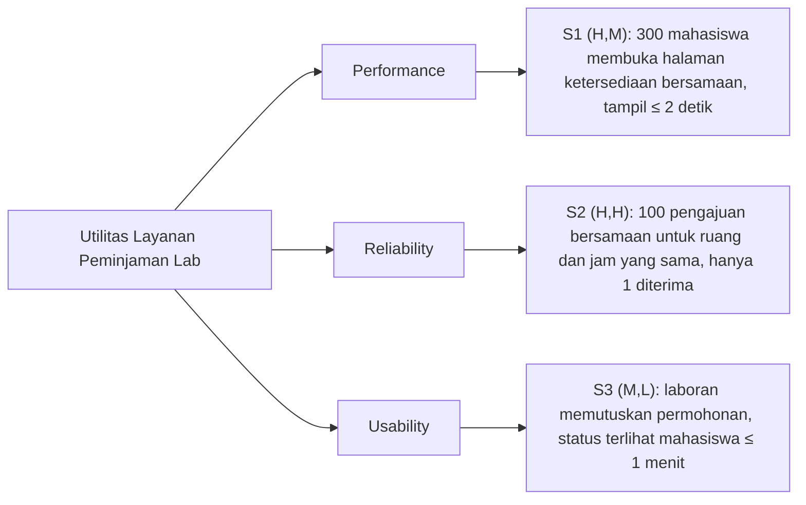

# BAB V EVALUASI DAN ADR

**Nama:** Rendi Pratama  
**NIM:** 13020240184  
**Bagian:** U6 – Evaluasi

Bab ini mengevaluasi rancangan Layanan Peminjaman Ruang Laboratorium FIKOM UMI terhadap tiga skenario pada BAB II, taktik dan pola pada BAB III, serta desain pada BAB IV. Evaluasi menggunakan pohon utilitas dan analisis ala ATAM [1], [3].

Masalah utama yang dievaluasi (subbab 1.2): **mahasiswa belum dapat mengetahui ketersediaan laboratorium secara mandiri dan harus bertanya langsung kepada laboran** (Bukti 1 dari R1, Bukti 2 dari R2).

## 5.1 Pohon Utilitas Mini

Setiap skenario diberi peringkat (kepentingan bisnis, kesulitan teknis): H = tinggi, M = sedang, L = rendah [3].

*Gambar 5.1 Pohon utilitas mini*

| Skenario | Peringkat | Alasan |
|---|---|---|
| S1 – Performance | (H,M) | Langsung menjawab masalah utama. Beban 300 pengguna masih wajar untuk satu server dengan indeks. |
| S2 – Reliability | (H,H) | Informasi ketersediaan hanya dapat dipercaya jika satu slot tidak diberikan kepada dua peminjam (Bukti tambahan dari R2). Penanganan 100 permintaan serentak sulit dibuat benar dan diuji. |
| S3 – Usability | (M,L) | Mendukung masalah utama (Bukti 3 dari R1). Penerapannya sederhana dengan polling. |

Prioritas evaluasi: **S2 → S1 → S3**.

## 5.2 Trade-off Berbobot Dua Alternatif

- **Alternatif A (dipilih):** Client-Server dengan pola Layered, Repository, dan State; *pessimistic locking* per slot; polling status setiap 30 detik.
- **Alternatif B:** *Microservices* (ketersediaan, peminjaman, dan status sebagai layanan terpisah dengan basis data masing-masing); *optimistic locking*; status dikirim melalui WebSocket.

Skor 1–5 (5 = terbaik); nilai = bobot × skor.

| Kriteria | Bobot | A | B | Alasan |
|---|---|---|---|---|
| Reliability (S2) | 0,35 | 5 → 1,75 | 3 → 1,05 | A: satu transaksi di `JadwalRepository` pada satu Basis Data Jadwal. B: data tersebar antarlayanan sehingga konsistensi butuh koordinasi tambahan. |
| Performance (S1) | 0,25 | 4 → 1,00 | 4 → 1,00 | Pada 300 pengguna, keduanya cukup dengan indeks. |
| Usability (S3) | 0,15 | 4 → 0,60 | 5 → 0,75 | A: keterlambatan status maksimal ±30 detik. B: hampir seketika. |
| Kemudahan pengembangan dan operasional | 0,25 | 5 → 1,25 | 2 → 0,50 | A: satu aplikasi dan satu basis data. B: banyak layanan, *deployment*, dan pemantauan. |
| **Total** | **1,00** | **4,60** | **3,30** | |

Alternatif A dipilih. B hanya unggul pada kecepatan status, padahal A sudah memenuhi target S3. Harga yang dibayar A adalah status yang tidak *real-time* dan satu server sebagai titik kegagalan tunggal (R2).

## 5.3 Analisis ala ATAM

| Jenis | Temuan | Skenario | Penjelasan |
|---|---|---|---|
| **Risiko R1** | Penguncian slot membuat 100 permintaan pada slot yang sama antre di `JadwalRepository`. | S2, S1 | Antrean dapat memicu *timeout* sehingga mahasiswa kembali bertanya ke laboran. Mitigasi: kunci hanya baris slot, transaksi singkat, batas tunggu kunci 3 detik (usulan). |
| **Risiko R2** | Seluruh lapisan berjalan pada satu server dengan satu Basis Data Jadwal. | S1, S2, S3 | Jika server mati, ketersediaan, pengajuan, dan status berhenti bersamaan, sehingga masalah utama muncul kembali. Mitigasi: cadangan harian dan pemantauan *uptime*. |
| **Non-risiko N1** | Indeks pada tanggal dan jam cukup untuk S1 tanpa *cache*. | S1 | Data jadwal laboratorium FIKOM kecil, sehingga `cariByTanggal` hanya membaca sedikit baris. Tambahan waktu dari pola Layered hanya dalam hitungan milidetik. |
| **Sensitivity point SP1** | Interval polling pada Antarmuka Mahasiswa. | S3 | Interval 30 detik memenuhi target ≤ 1 menit, sedangkan interval 90 detik tidak. Beban polling = 300 pengguna ÷ 30 detik = 10 permintaan/detik. |
| **Trade-off point TP1** | Cakupan penguncian di `JadwalRepository.simpanJikaKosong`. | S2 vs S1 | Penguncian lebih ketat (kunci tabel atau `SERIALIZABLE`) memperkuat S2 tetapi memperlambat S1. Penguncian lebih longgar mempercepat S1 tetapi membuka peluang jadwal ganda. Rancangan memilih kunci per slot (ADR-003). |

## 5.4 Apakah Masalah Utama Teratasi?

**Teratasi pada tingkat rancangan, tetapi belum terbukti.**

- **Ketersediaan (masalah utama):** Teratasi oleh S1. Mahasiswa melihat ruang kosong dan terpakai melalui Layanan Ketersediaan dalam ≤ 2 detik. S2 menjamin informasi itu benar karena satu slot tidak dapat diambil dua peminjam.
- **Status permohonan (Bukti 3):** Teratasi oleh S3. Status terlihat ≤ 1 menit setelah laboran memutuskan, tanpa perlu bertanya langsung.
- **Yang belum teratasi:**
  1. Semua target masih usulan dan baru sah setelah uji beban 300 pengguna (S1) dan uji 100 pengajuan serentak (S2).
  2. Risiko R2 tetap ada. Jika server mati, mahasiswa kembali bergantung pada laboran.
  3. Permohonan berstatus Menunggu sudah memegang slot (Gambar 4.4). Slot tampil terpakai sebelum laboran memutuskan, dan baru dilepas jika permohonan ditolak.
  4. Aturan penggunaan (KF-4) dan pengaturan kebijakan oleh Kepala Laboratorium (KF-5) belum memiliki komponen sendiri pada Gambar 4.2.
