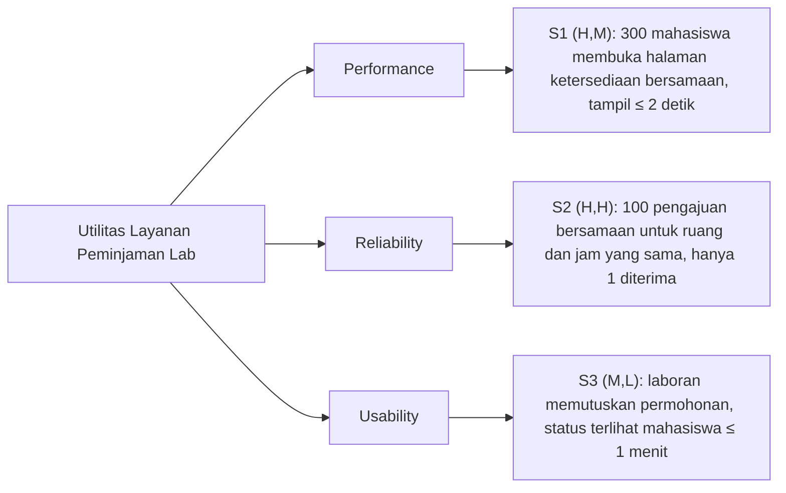

# BAB V EVALUASI DAN ADR

**Nama:** Rendi Pratama  
**NIM:** 13020240184  
**Bagian:** U6 – Evaluasi

Rancangan dievaluasi dengan pohon utilitas dan analisis ala ATAM [1], [3] terhadap masalah utama (subbab 1.2): **mahasiswa belum dapat mengetahui ketersediaan laboratorium secara mandiri dan harus bertanya langsung kepada laboran.**

## 5.1 Pohon Utilitas Mini

Peringkat ditulis sebagai (kepentingan bisnis, kesulitan teknis): H = tinggi, M = sedang, L = rendah [3].

*Gambar 5.1 Pohon utilitas mini*

S1 bernilai H karena langsung menjawab masalah utama. S2 bernilai (H,H) karena informasi ketersediaan hanya dapat dipercaya jika satu slot tidak diberikan kepada dua peminjam, dan penanganan 100 permintaan serentak sulit diuji. S3 mendukung masalah utama (Bukti 3) dan sederhana diterapkan. Prioritas evaluasi: **S2 → S1 → S3**.

## 5.2 Trade-off Berbobot Dua Alternatif

**Alternatif A** (dipilih): Client-Server dengan pola Layered, Repository, dan State; *pessimistic locking* per slot; polling 30 detik. **Alternatif B**: *microservices* dengan basis data per layanan; *optimistic locking*; status melalui WebSocket. Skor 1–5; nilai = bobot × skor.

| Kriteria | Bobot | A | B | Alasan |
|---|---|---|---|---|
| Reliability (S2) | 0,35 | 5 → 1,75 | 3 → 1,05 | A: satu transaksi di `JadwalRepository`. B: data tersebar antarlayanan. |
| Performance (S1) | 0,25 | 4 → 1,00 | 4 → 1,00 | Pada 300 pengguna, keduanya cukup dengan indeks. |
| Usability (S3) | 0,15 | 4 → 0,60 | 5 → 0,75 | A: terlambat maksimal ±30 detik. B: hampir seketika. |
| Kemudahan pengembangan dan operasional | 0,25 | 5 → 1,25 | 2 → 0,50 | A: satu aplikasi dan satu basis data. B: banyak layanan dan *deployment*. |
| **Total** | **1,00** | **4,60** | **3,30** | |

A dipilih. B hanya unggul pada kecepatan status, padahal A sudah memenuhi S3. Harga yang dibayar A: status tidak *real-time* dan satu server menjadi titik kegagalan tunggal (R2).

## 5.3 Analisis ala ATAM

| Jenis | Temuan | Skenario | Penjelasan |
|---|---|---|---|
| **Risiko R1** | 100 permintaan pada slot yang sama antre karena penguncian di `JadwalRepository`. | S2, S1 | Antrean dapat memicu *timeout*. Mitigasi: kunci hanya baris slot dan batas tunggu 3 detik (usulan). |
| **Risiko R2** | Seluruh lapisan berjalan pada satu server dan satu Basis Data Jadwal. | S1–S3 | Jika server mati, masalah utama muncul kembali. Mitigasi: cadangan harian dan pemantauan *uptime*. |
| **Non-risiko N1** | Indeks tanggal dan jam cukup untuk S1 tanpa *cache*. | S1 | Data jadwal laboratorium FIKOM kecil, dan tambahan waktu pola Layered hanya hitungan milidetik. |
| **Sensitivity point SP1** | Interval polling pada Antarmuka Mahasiswa. | S3 | 30 detik memenuhi ≤ 1 menit, 90 detik tidak. Beban = 300 ÷ 30 = 10 permintaan/detik. |
| **Trade-off point TP1** | Cakupan penguncian di `simpanJikaKosong`. | S2 vs S1 | Kunci lebih ketat memperkuat S2 tetapi memperlambat S1, dan sebaliknya. Dipilih kunci per slot (ADR-003). |

## 5.4 Apakah Masalah Utama Teratasi?

**Teratasi pada tingkat rancangan, tetapi belum terbukti.** S1 membuat mahasiswa melihat ketersediaan sendiri dalam ≤ 2 detik, dan S2 menjamin informasi itu benar. S3 menampilkan status ≤ 1 menit tanpa bertanya ke laboran. Yang tersisa: (1) semua target masih usulan dan harus diuji dengan 300 pengguna dan 100 pengajuan serentak; (2) risiko R2 tetap ada; (3) permohonan berstatus Menunggu sudah memegang slot (Gambar 4.4), sehingga slot tampil terpakai sebelum diputuskan; (4) KF-4 dan KF-5 belum memiliki komponen pada Gambar 4.2.
